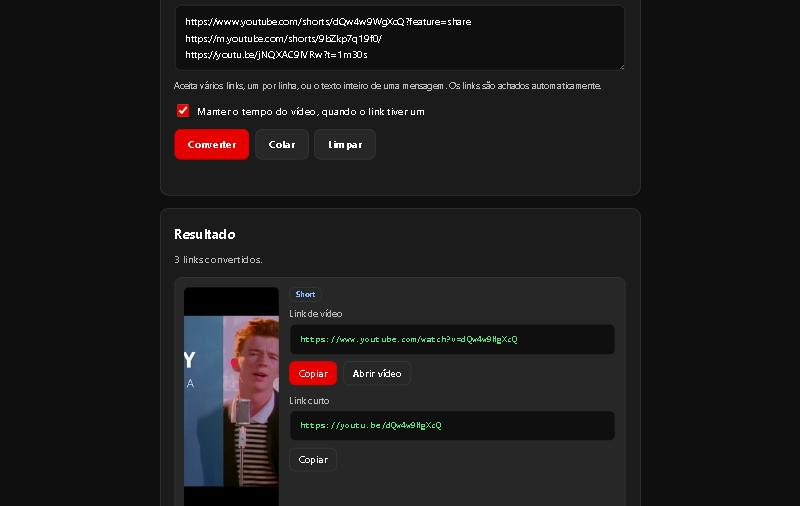

# Conversor de Shorts (Shorts Converter)

Ferramenta web que transforma links do **YouTube Shorts** em links de vídeo comuns, direto no navegador. Funciona em português e inglês.

**Ver online:** https://hugohendrix.github.io/shorts-converter/



## O que faz

- **Converte vários links de uma vez** e acha os links dentro de um texto colado, como uma mensagem inteira.
- **Aceita vários formatos:** Shorts (`/shorts/`), links do celular (`m.youtube.com`), links curtos (`youtu.be`), vídeos comuns (`/watch`), `embed` e `live`, com ou sem `https://`, com barra no final ou parâmetros extras.
- **Mostra a miniatura** do vídeo para você conferir se é o certo e gera o **link padrão** e o **link curto**.
- **Mantém o tempo do vídeo** (`?t=`), se o link tiver um.
- **Copiar, abrir e compartilhar** em um clique, mais o botão **Colar** e o **histórico recente** (guardado só no seu navegador).
- **Botão no navegador (bookmarklet):** arraste para a barra de favoritos e converta o Short que você está vendo no computador.
- **Instalável como app (PWA):** no celular, o botão Compartilhar do YouTube passa a mostrar o Conversor de Shorts, e o link chega convertido. Funciona offline depois da primeira visita.

## Decisões técnicas

- **HTML, CSS e JavaScript puros**, sem frameworks, sem etapa de build e sem Tailwind por CDN.
- **Conversor separado da tela** (`js/converter.js`): funções puras, fáceis de testar.
- **42 testes automáticos** em [`tests.html`](tests.html), que rodam no próprio navegador e cobrem formatos válidos, erros, tempo, links finais e múltiplos links. Para rodar, abra a página.
- **Textos no HTML:** o conteúdo em português já vem na página (bom para buscadores e para quem não usa JavaScript), e o inglês é trocado pelo `js/i18n.js`. O idioma escolhido fica salvo e o atributo `lang` é atualizado.
- **Acessibilidade:** rótulos em todos os campos, erros e resultados anunciados a leitores de tela (`role="alert"` e `aria-live`), foco visível, teclado completo e respeito a `prefers-reduced-motion`.
- **Feedback honesto:** o botão só mostra "Copiado!" quando a cópia deu certo, com plano B para navegadores sem a API de área de transferência.
- **Privacidade:** nenhum link é enviado a servidor. A única requisição externa é a miniatura, carregada do servidor de imagens do YouTube.
- **SEO e compartilhamento:** título e descrição próprios, Open Graph, Twitter Card, dados estruturados (`WebApplication`), `canonical`, `robots.txt` e `sitemap.xml`.

## Como rodar

Não há etapa de build. Abra o `index.html` no navegador ou use um servidor local (necessário para testar o app instalável):

```bash
python -m http.server 8000
```

Depois acesse http://localhost:8000.

## Estrutura

```
index.html              página, com os textos em português
css/style.css           estilos
js/converter.js         lógica de conversão (funções puras)
js/i18n.js              textos em português e inglês
js/app.js               tela: resultado, histórico, cópia, instalação
tests.html              testes automáticos do conversor
sw.js                   service worker (uso offline)
manifest.webmanifest    app instalável e destino do botão Compartilhar
img/                    ícones e imagem de compartilhamento
```

## Como o projeto nasceu

A primeira versão foi criada como um experimento de programação assistida por IA: uma conversa com um assistente de IA do Google gerou o conceito e um único `index.html`. Depois eu revisei o código com ajuda do Claude Code, corrigi os problemas encontrados (formatos de link não aceitos, acessibilidade, SEO, arquivos vazios, licença) e reescrevi o projeto com testes e novos recursos. É um exemplo de como uso IA: como acelerador, sempre revisando e testando o resultado.

## Licença

[MIT](LICENSE). Projeto independente, sem vínculo com o YouTube ou o Google.

## Autor

**Hugo Hendrix** · [Portfólio](https://hugohendrix.github.io/portfolio-hugo/) · [LinkedIn](https://www.linkedin.com/in/hugohendrix/) · [GitHub](https://github.com/HugoHendrix)
